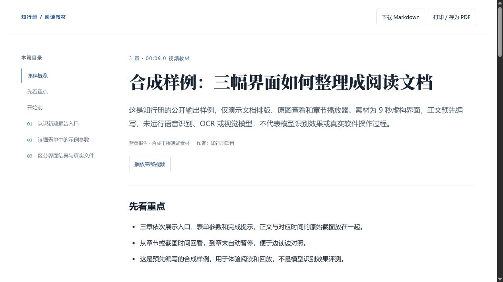

# 知行册 · Screen to Guide

**把视频整理成看得懂、跟得上的图文指南。**

把教学视频、软件录屏交给智能体，整理出原理讲解、操作步骤、关键截图和可复制的命令。读到某一步时，可以直接回看对应片段，到章末自动暂停，方便边看边做。

知行册是一个 Agent Skill，配套本地 Python 工具，输出可离线阅读的 HTML、Markdown 和结构化 JSON。适合课程整理、软件培训和工作交接。

[下载](https://github.com/Andonis75/screen-to-guide/releases/latest) · [快速开始](#快速开始) · [输出样例](examples/synthetic-guide/README.md) · [使用说明](references/usage.md) · [技术文档](docs/technical-design.md)



*阅读界面预览，使用仓库内置的合成样例。下载后打开 `examples/synthetic-guide/guide.html` 即可体验。*

## 能做什么

- **理解视频内容**：把讲解整理成概览、原理和示例，按主题分章。
- **照着步骤操作**：保留准备事项、入口、参数、命令和完成标志。
- **对照原始画面**：关键步骤配源视频截图，支持打开原图查看细节。
- **随时回看**：从章节或截图时间开始播放，到章末暂停，也可以继续观看完整视频。
- **减少重复处理**：优先复用已有字幕，缺少字幕时本地转写；材料处理支持中断续跑。
- **带走整理结果**：用浏览器阅读、打印为 PDF，或把 Markdown 和图片放进知识库。

支持本地视频，也可以通过可选的 yt-dlp 下载入口获取公开链接中的视频。

## 快速开始

### 1. 准备本地环境

当前以 **Windows + Python 3.11** 为主要运行环境。先安装 [FFmpeg](https://ffmpeg.org/download.html)，将 `ffmpeg` 和 `ffprobe` 加入 PATH。

从 [Releases](https://github.com/Andonis75/screen-to-guide/releases/latest) 下载并解压到 `screen-to-guide` 目录，在该目录打开 PowerShell：

```powershell
.\scripts\run.ps1 --setup

# 教学视频没有可用字幕时，需要这个语音模型
.\scripts\run.ps1 --prepare-model --kind asr

.\scripts\run.ps1 --doctor
```

环境、模型和缓存保存在项目的 `.runtime/` 中，建议把项目放在空间充足的磁盘。已有可用字幕时，可以跳过语音模型准备。教学模式无需下载视觉大模型；软件录屏需要本地视觉分析时，再运行：

```powershell
.\scripts\run.ps1 --prepare-model --kind vlm
```

视觉模型资产约 5.18 GB。模型选择、环境检查和下载问题见[使用说明](references/usage.md)。

### 2. 安装为 Skill

将完整项目放入智能体宿主的技能目录，名称保留为 `screen-to-guide`。以 Codex 为例，可以在项目根目录执行以下命令，建立目录链接，让模型继续保留在项目所在磁盘：

```powershell
$skillSource = (Get-Location).Path
$skillTarget = Join-Path $env:USERPROFILE '.codex\skills\screen-to-guide'
New-Item -ItemType Directory -Force -Path (Split-Path $skillTarget) | Out-Null
New-Item -ItemType Junction -Path $skillTarget -Target $skillSource
```

已有同名 Skill 时，更新原安装目录即可。其他宿主按各自的 Skill 安装方式导入本项目。

### 3. 交给智能体处理

安装完成后，向智能体提供视频路径和输出位置：

> 使用 $screen-to-guide，把 `D:\视频\教学.mp4` 整理成可以跟着做的图文指南，输出到 `D:\文档\教学`。讲清原理和操作步骤，保留关键截图、命令与章节回看。

智能体会准备字幕或转写、截图和画面文字，结合原片整理正文，再通过固定渲染器生成文档。软件操作录屏也使用同一个 Skill，由智能体选择对应流程。

完成后打开输出目录中的 `guide.html`。分享给别人时，将整个输出目录一起打包，保留其中的图片和视频文件。

## 输出是什么样的

| 文件 | 用途 |
| --- | --- |
| `guide.html` | 在浏览器中阅读，查看原图、回看章节、打印为 PDF |
| `guide.md` | 复制内容、继续编辑或导入知识库 |
| `lesson.json` / `steps.json` | 保存章节或步骤、时间定位与来源信息 |
| `frames/` 和视频副本 | 文档引用的截图与本地回放素材 |

[查看合成样例](examples/synthetic-guide/README.md)，或直接阅读其 [Markdown 文档](examples/synthetic-guide/guide.md)。

## 也可以使用命令行

环境准备完成后，直接提取一段教学视频的材料：

```powershell
.\.runtime\venv\Scripts\python.exe -X utf8 scripts/prepare_lesson.py `
  "D:\视频\教学.mp4" --output-dir "D:\文档\教学"
```

这个命令生成转写、截图和 OCR 材料；完整教材继续由 Agent 整理，或自行编写中间稿后渲染。同一材料任务中断后，在原命令末尾加 `--resume` 续跑。

| 需要做的事 | 对应说明 |
| --- | --- |
| 下载公开链接中的视频与字幕 | [公开链接获取](references/usage.md#可选公开链接获取) |
| 指定字幕、强制转写、恢复材料任务 | [字幕与恢复处理](references/usage.md#教学材料字幕优先与恢复处理) |
| 调整软件录屏分析参数 | [处理录屏](references/usage.md#处理录屏) |
| 编写、修改和重新生成教学文档 | [教学流程](references/teaching-guide.md) |
| 排查环境、模型和媒体问题 | [故障定位](references/usage.md#失败时) |

## 使用前了解

- 当前单段视频上限为 **30 分钟、2 GiB**；长课程先按内容拆分。
- 截图清晰度取决于源视频。链接下载选择可取得的最高不超过 1080p 的格式；下载受平台与访问权限影响，也可直接使用本地视频。
- 抽帧、OCR 和语音转写在本机运行；智能体整理阶段的数据处理方式取决于所用宿主。输出保留视频原内容，不自动脱敏。

本地推理使用 OpenVINO，配合 Whisper、PP-OCR 和可选视觉模型。具体模型、处理流程与验证结果见[技术文档](docs/technical-design.md)和[验证记录](docs/validation.md)。

## 开发与贡献

欢迎通过 [Issues](https://github.com/Andonis75/screen-to-guide/issues) 反馈使用问题、遗漏步骤或改进建议。复现信息建议包含运行环境、命令和错误信息；分享样例前请移除个人信息与访问凭据。

[开发说明](docs/development.md) · [Skill 工作流](SKILL.md) · [第三方组件](THIRD_PARTY_NOTICES.md)

项目自有代码与文档采用 [MIT 许可证](LICENSE)，第三方代码及模型遵循各自许可证。
