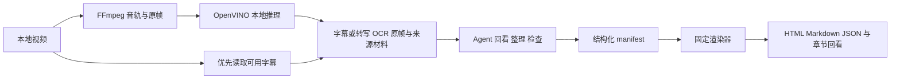

# 知行册 · Screen to Guide

**把视频整理成看得懂、跟得上的图文指南。**

知行册是供 Agent 调用的 Skill，也提供独立 Python 工具。它优先读取已有字幕，缺少可用字幕时用 Intel OpenVINO 在本机转写，结合 OCR、原帧或视觉模型准备带时间戳的材料；智能体回看原片，整理步骤、解释和代码，再通过固定渲染器生成 HTML、Markdown 与来源 JSON。技术标识和调用名称仍为 `screen-to-guide`。

适合软件培训、工作交接、操作复盘和课程整理。当前版本 **0.2.0**，Windows 优先，CPU 已实测。

[技术文档](docs/technical-design.md) · [验证记录](docs/validation.md) · [使用说明](references/usage.md) · [教学流程](references/teaching-guide.md) · [输出样例](examples/synthetic-guide/README.md)


上图为随仓库提供的合成输出样例，只展示阅读体验，不作为模型识别效果证明。

## 解决什么问题

看完视频不等于能复现操作。读者常常需要反复拖动进度条，寻找入口、参数、命令或最终结果；单纯的字幕摘要又容易省掉这些细节。

- 文档写清准备事项、操作入口、输入参数和完成标志。
- 关键位置保留源视频截图，点击可查看原图。
- 教学视频按主题组织原理、示例、操作和代码块，保留章节时间范围。
- 先用简洁概览说明重点，再提供完整章节和分步操作。
- 同名字幕可复用；材料任务中断后显式续跑，校验已完成产物后继续处理。
- 点击“播放本章”或截图时间回看，到章末自动暂停；需要连续观看时选择“继续播放完整视频”。
- 使用相对路径打包 HTML、Markdown、截图和可选视频副本，便于离线阅读与交接。

项目强调理解、操作步骤与来源追溯。截图、章节和视频笔记并非本项目独有功能；单条视频对照也不足以证明对所有视频或模型配置都更准确，目前没有多样本公开对比基准。

## 两种处理流程

| 输入 | 本地程序 | 智能体 | 最终结果 |
| --- | --- | --- | --- |
| 软件操作录屏 | 抽帧、OCR、可选转写、Qwen2.5-VL 画面观察 | 回看关键片段，关联动作依据，独立复审并写步骤 | 操作指南及 `steps.json` |
| 教学视频 | 优先读取字幕，必要时完整音轨转写；全片原帧、OCR、覆盖索引与阶段缓存 | 阅读材料与画面，编写简洁概览、原理、操作和代码，检查漏项 | 章节教材及 `lesson.json` |

独立 CLI 首次处理产生材料或可编辑初稿。完成教程需要 Agent 继续整理，或由使用者编写中间 manifest。教学材料准备不运行大型视觉模型。



公开链接可先通过可选 `acquire_video.py` 取得完整媒体与可用字幕，再进入本地处理。下载入口选择可取得的最高不超过 1080p 的格式，记录实际清晰度；平台支持、访问权限和源文件质量仍会影响结果，不保证任意链接都能下载或达到 1080p。

## 英特尔技术用在什么地方

| 组件 | 负责的工作 | 当前实现 |
| --- | --- | --- |
| Intel OpenVINO Runtime | 编译和运行 OCR 模型 | PP-OCRv4 检测、方向分类与文字识别；CPU |
| Intel OpenVINO GenAI `WhisperPipeline` | 缺少可用字幕时进行带时间戳的语音转写 | Whisper base FP16 OpenVINO 格式；CPU 已实测 |
| Intel OpenVINO GenAI `VLMPipeline` | 软件录屏画面观察 | Qwen2.5-VL-7B INT4 OpenVINO 格式；CPU 已实测，教学流程不调用 |

OpenVINO 是 Intel 提供的推理软件。Whisper 原模型来自 OpenAI，Qwen2.5-VL 来自 Qwen，PP-OCRv4 来自 PaddleOCR。固定版本与归属见 [config.json](config.json) 和[第三方说明](THIRD_PARTY_NOTICES.md)。[OpenVINO 官方介绍](https://www.intel.com/content/www/us/en/developer/tools/openvino-toolkit/overview.html)

目前验证设备是 Windows 电脑的 AMD Ryzen 7 8845H CPU，证明了 OpenVINO 软件栈在本项目中的实际可运行性；Intel AI PC、Intel GPU、NPU 的性能和兼容性仍待专门验证。

## 快速开始

准备 **Windows、Python 3.11、FFmpeg 与 FFprobe**，确认以下命令可用：

```powershell
python --version
ffmpeg -version
ffprobe -version
```

`--setup` 只准备项目自己的 Python 环境与依赖，不安装 FFmpeg。安装来源可从 [FFmpeg 官方页面](https://ffmpeg.org/download.html)选择；软件录屏入口支持 `--ffmpeg`、`--ffprobe` 指定完整路径，教学与下载入口要求工具可从 PATH 找到。项目应放在有足够空间的磁盘，模型、环境和缓存默认存放在项目内 `.runtime/`。

### 让 Agent 调用 Skill

把完整项目安装到宿主的技能目录，保留名称 `screen-to-guide`。例如 Codex 使用 `~/.codex/skills/screen-to-guide`；也可使用指向现有项目的目录链接，避免复制模型。

首次准备教学视频所需环境与语音模型；已有可用字幕时会跳过语音推理：

```powershell
.\scripts\run.ps1 --setup
.\scripts\run.ps1 --prepare-model --kind asr
.\scripts\run.ps1 --doctor
.\scripts\run.ps1 --capabilities
```

然后对智能体说：

> 使用 $screen-to-guide，把 `D:\视频\教学.mp4` 整理成可跟做的教学文档，输出到 `D:\文档\教学`。保留关键截图和章节回看，通过 Skill 固定渲染器生成最终文件。

软件录屏的本地视觉分析另需执行 `.\scripts\run.ps1 --prepare-model --kind vlm`，视觉模型资产约 5.18 GB。教学模式无需默认下载这份大型视觉模型。

### 独立使用教学材料工具

```powershell
# 优先复用同名字幕；无可用字幕时本地转写，首次输出使用新目录
.\.runtime\venv\Scripts\python.exe -X utf8 scripts/prepare_lesson.py `
  "D:\视频\教学.mp4" --output-dir "D:\文档\教学" --max-frames 96

# 同一任务中断后，校验并复用已完成阶段
.\.runtime\venv\Scripts\python.exe -X utf8 scripts/prepare_lesson.py `
  "D:\视频\教学.mp4" --output-dir "D:\文档\教学" --max-frames 96 --resume

# Agent 写好中间稿后，生成最终文档
.\.runtime\venv\Scripts\python.exe -X utf8 scripts/render_lesson.py `
  --manifest "D:\文档\教学\analysis\lesson-manifest.json" `
  --output-dir "D:\文档\教学"
```

材料入口不会直接写出完整教材。可用 `--subtitle-file "D:\视频\教学.zh.srt"` 指定字幕，或 `--no-subtitles` 强制 ASR；字幕时间覆盖筛选不等于内容准确性保证。`--resume` 会拒绝混用不同源视频、字幕或参数，不自动继续智能体写作。中间稿格式和检查要求见[教学流程](references/teaching-guide.md)。修订时修改中间稿并重新渲染，覆盖已有成品需显式添加 `--overwrite-guide`。

### 从公开链接取得素材

首次显式安装可选下载依赖，再下载单条视频；此命令不下载模型。先在项目根目录把 pip 缓存与安装临时目录设到项目所在磁盘，设置只影响当前 PowerShell 会话：

```powershell
$skillCache = Join-Path (Get-Location).Path '.runtime\cache'
$env:PIP_CACHE_DIR = Join-Path $skillCache 'pip'
$env:TMP = Join-Path $skillCache 'tmp'
$env:TEMP = $env:TMP
New-Item -ItemType Directory -Force -Path $env:PIP_CACHE_DIR,$env:TMP | Out-Null
.\.runtime\venv\Scripts\python.exe -m pip install --cache-dir .runtime/cache/pip -r requirements-download.txt
.\.runtime\venv\Scripts\python.exe -X utf8 scripts/acquire_video.py `
  "https://www.bilibili.com/video/VIDEO_ID/" --output-dir "D:\视频\素材"
```

使用 `acquisition-status.json` 返回的本地视频路径继续处理。可加 `--resume` 恢复相同下载任务；可取得的字幕会作为同名文件保存，字幕获取失败时保留完整视频并说明本地 ASR 回退。只嵌在画面里的字幕仍需要语音转写或画面阅读。

### 独立使用软件录屏分析

```powershell
.\scripts\run.ps1 --prepare-model --kind vlm
.\scripts\run.ps1 "D:\视频\软件操作.mp4" --output-dir "D:\文档\软件操作"
```

默认最多 12 帧，得到画面分析初稿；Agent 按 [SKILL.md](SKILL.md) 回看关键动作并补充动作记录。只想抽取证据时显式使用 `--mode evidence`。更多参数见[使用说明](references/usage.md)。

## 输出与验证

| 文件 | 用途 |
| --- | --- |
| `guide.html` | 可离线打开的阅读文档，包含章节回看、原图入口和打印功能 |
| `guide.md` | 便于复制、编辑、导入知识库的正文 |
| `lesson.json` / `steps.json` | 章节或步骤、时间戳、媒体引用和来源记录 |
| `frames/` | 源视频截图，保留相对路径 |
| `playback.mp4` 或源文件副本 | 可选回放媒体；转码信息保留在处理记录 |

2026-10-25 的真实教学视频验证：**15 分 10 秒、1920×1080，整理为 13 章与 17 张截图**。本地材料准备读取完整音轨，得到 425 条转写片段、96 张 OCR 画面，耗时 206.144 秒。该时间只涵盖材料准备，不含下载、Agent 整理和复审；一次样例不代表通用准确率或固定处理速度。[查看验证记录](docs/validation.md)

[合成输出样例](examples/synthetic-guide/README.md)可体验布局、原图和章末暂停。它由预先编写的虚构材料生成，只用于展示输出与工程流程。

## 范围与隐私

- 默认单段输入不超过 30 分钟、2 GiB；更长视频需要显式分段并保留时间偏移，当前没有自动长课程编排入口。
- 教学模式默认 64 帧，最高 96 帧。完整音轨加抽样画面不等于逐帧理解，短暂弹窗、细小代码和无声动作可能需要补采片段。
- OCR、转写和模型描述可能出错。动作引用与时间校验检查结构一致性，语义正确性仍需对照原片。
- 依赖和模型首次准备需要联网。之后本地程序负责媒体处理和推理；Agent 宿主是否向云端发送截图或文本取决于宿主，整个工作流不因此获得完全离线保证。
- 本地处理脚本不需要云端模型 API Key；Agent 宿主仍可能有订阅或调用费用。
- 视频副本、截图和转写保留原内容，不做自动隐私脱敏。源文件不被改写；兼容副本可能有压缩和颜色变化。

## 开发与后续方向

手动安装开发依赖前，先在同一 PowerShell 会话执行上述[项目缓存设置](#从公开链接取得素材)，让 pip 缓存与临时文件继续保留在项目所在磁盘。

```powershell
$env:PYTHONUTF8="1"
.\.runtime\venv\Scripts\python.exe -m pip install --cache-dir .runtime/cache/pip -r requirements-dev.txt
.\.runtime\venv\Scripts\python.exe -m pytest -q
node --test tests/test_lesson_playback.cjs
```

Node.js 仅用于播放器行为测试。第三方 OCR 的许可证与修改提示保留在 `vendor/`。

后续优先建设：多视频的步骤和参数正确性评测、超长课程分段编排，以及 Intel AI PC 上的 CPU/GPU/NPU 对照验证。以上是计划，不列入当前已完成功能。

项目自有代码与文档采用 [MIT 许可证](LICENSE)。`vendor/` 代码和模型等第三方内容继续遵循各自的[许可证与归属](THIRD_PARTY_NOTICES.md)，不因本项目选择 MIT 而改变。
