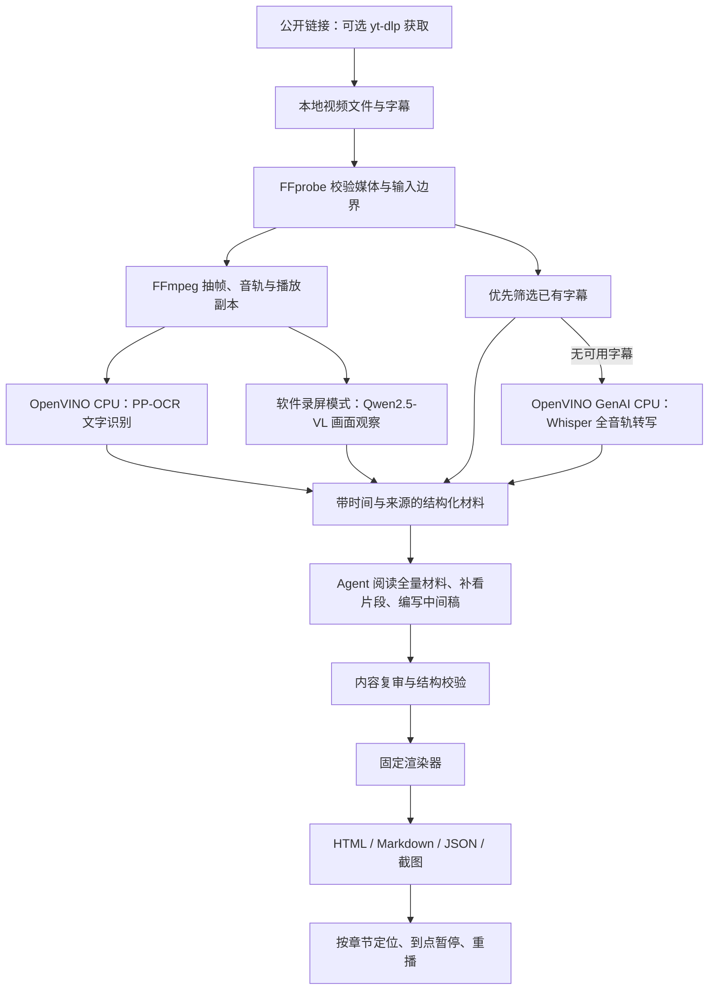

# 知行册：技术设计与运行说明

适用版本：0.2.0。更新日期：2026-10-25。

知行册（Screen to Guide）是一套由 Agent Skill 与本地 Python 程序共同完成的视频转文档流程。它把软件操作录屏或教学视频整理成看得懂、跟得上的图文指南，输出 HTML、Markdown、结构化 JSON 与截图。技术标识与仓库名称保留 `screen-to-guide`。

项目要解决的是视频知识难以理解、查找和复用的问题：学习者为了找一个按钮、命令或参数，往往需要反复拖动进度；文档制作者则需要整理旁白、截图、记录时间、解释原理和组织步骤，再逐项核对。知行册把这些工作接到同一条流程里，同时保留正文与原片之间的联系。

## 1. 系统分工



程序负责可重复的材料准备、校验和渲染；Agent 负责结合旁白与画面整理教学逻辑、识别遗漏、编写正文并完成内容检查。独立 CLI 可以生成材料和分析初稿；完整教材需要继续执行 Skill 规定的整理与复核环节。`prepare_lesson.py` 本身不会自动写出完整教材。

网页、字幕、旁白、OCR 和模型回答均被视为输入材料。Skill 不会因视频里出现一条命令就执行它，也不会自动操作视频所演示的软件或账号。

## 2. 英特尔技术具体用在哪里

本项目使用英特尔提供的 **OpenVINO Runtime 与 OpenVINO GenAI** 执行本地模型推理。OpenVINO 是运行和优化模型的软件工具；Whisper、Qwen 与 PP-OCR 是由相应模型项目提供的模型，二者职责不同。

| 本项目能力 | Intel 组件与实际调用 | 模型来源 | 当前实现与实测范围 |
| --- | --- | --- | --- |
| 语音转写 | `openvino_genai.WhisperPipeline`，兼容 `ASRPipeline`；生成带时间戳的转写段落 | OpenAI Whisper base；使用 OpenVINO 发布的 FP16 转换版本 | 教学模式缺少可用字幕时将完整音轨送入本地 CPU；软件模式可选启用 |
| 画面文字识别 | `openvino.Core()` → `read_model()` → `compile_model(..., "CPU")` → `infer()` | PaddleOCR 的 PP-OCRv4 检测、识别模型，配套方向分类模型；经 RapidOCR 封装 | 检测并识别抽取画面中的按钮、字段、命令等文字；当前适配器固定使用 CPU |
| 软件界面观察 | `openvino_genai.VLMPipeline` 与 `openvino.Tensor` | Qwen2.5-VL-7B-Instruct；使用 OpenVINO 发布的 INT4 转换版本 | 软件录屏模式默认 CPU；教学模式不调用此视觉大模型 |

对应代码在 [`scripts/screen_guide/inference.py`](../scripts/screen_guide/inference.py) 与 [`vendor/rapidocr_openvino/utils/infer_engine.py`](../vendor/rapidocr_openvino/utils/infer_engine.py)。依赖固定为 `openvino==2026.4.1`、`openvino-genai==2026.4.1.0`；以 [`requirements.txt`](../requirements.txt) 为准。

当前实测设备是 Windows 上的 AMD Ryzen 7 8845H，约 27.75 GiB 内存。**已验证的是 OpenVINO 软件栈的 CPU 推理流程；尚未提供 Intel AI PC、Intel GPU 或 NPU 的实测成绩，也没有相对其他推理后端的加速倍率。** 代码接受设备参数，不等于所有设备、模型组合都已经适配并验收。

模型仓库、固定 revision、默认设备及帧数保存在 [`config.json`](../config.json)。模型准备过程记录来源与下载时间，处理阶段读取本地权重。具体第三方来源及许可证见 [`THIRD_PARTY_NOTICES.md`](../THIRD_PARTY_NOTICES.md)。

## 3. 两种内容处理模式

### 软件操作录屏

入口为 [`scripts/run.ps1`](../scripts/run.ps1) 或 [`scripts/run.py`](../scripts/run.py)。默认通过 OpenVINO GenAI 分析选中的软件画面，最多保留 12 帧；OCR 提供文字线索，语音转写可通过 `--transcribe` 开启。

视觉模型的输出限于当前画面可见的状态。画面显示“导出完成”，只说明该时刻出现了这条提示；按钮出现或页面变化本身也不证明某一次点击。Agent 随后回看关键动作前后片段，区分用户操作和系统自动继续，建立动作依据，再写操作指南。

最终操作稿通过 `action_refs` 关联动作记录。严格渲染检查缺失引用、分类冲突和字段一致性；这类结构检查不替代观看视频判断操作是否真实发生。独立复审流程见 [`references/action-evidence.md`](../references/action-evidence.md)。

### 教学视频

入口为 [`scripts/prepare_lesson.py`](../scripts/prepare_lesson.py)。它先寻找与视频同名、或附语言后缀的 SRT、VTT、JSON3 字幕，也接受显式字幕或转写导入。材料流程记录字幕来源，检查格式、时间顺序与覆盖范围；时间筛选不通过时回退本地全音轨 ASR。画面里已经显示字幕，不代表存在独立可读取的字幕文件。

随后默认最多提取 64 张画面，可调整至 96 张，并生成 OCR、联系表与每 30 秒的材料覆盖索引。索引明确记录该时间窗是否实际存在文字与截图；邻近截图不会被标成窗内证据。字幕来源与是否执行过 ASR 分别记录，不把导入字幕标成模型转写成绩。

Agent 阅读全部字幕或转写并按时间查看联系表，必要时查看原图或用 `sample_sequence.py` 补采短片段，随后编写 `analysis/lesson-manifest.json`。正文先用可选 `quick_overview` 概览主要知识与流程，再提供章节说明、准备事项、实操步骤、代码块、原始截图、视频时间与必要参考资料。包名、启动命令、参数层级和路径需要对照可见画面；图注只描述该图实际显示的状态。原片中未演示的内容不会被写成已经演示完成。

固定入口 [`scripts/render_lesson.py`](../scripts/render_lesson.py) 从中间稿一次生成 `guide.html`、`guide.md`、`lesson.json`。需要修改正文时，修订中间稿后重新生成，不直接补写最终 HTML 或 Markdown。

### 处理结果复用

教学入口的 `--resume` 根据源视频哈希、字幕来源及处理参数核对任务身份，再检查各阶段产物的哈希。完成的字幕/转写、音轨、抽帧与联系表、OCR、播放副本可以复用；缺失或损坏的阶段重新生成，输入或参数变化则要求新目录。缓存与来源记录留在该输出目录，不通过猜测文件名跨视频复用。

阶段缓存降低失败重跑成本，不等于 Agent 的内容写作和复审自动断点恢复。字幕命中与缓存命中都不免除原片核对，也不把模型置信度转换成准确率。

## 4. 媒体、时间轴与阅读体验

媒体处理由 [`scripts/screen_guide/media.py`](../scripts/screen_guide/media.py) 执行。

- 单段输入上限为 30 分钟、2 GiB；仅接受本地文件。超长视频需要先明确分段范围与原片时间偏移，当前入口不自动编排长课程分段。
- 选帧兼顾时间覆盖和场景变化，最多保留 96 帧。时间来自解码后的真实 PTS，并按源时间起点归零，不用帧号除以假定帧率伪造时间。
- 截图从源文件提取，最大宽度为 1920 像素，不为低清源虚构清晰细节；供模型分析的缩放图和阅读截图用途不同。
- 音轨转换为 16 kHz、单声道、16 位 PCM，再送给本地 Whisper；当前转写调用指定中文。
- 不兼容浏览器的媒体可生成 H.264/AAC 播放副本。副本属于有损派生文件，来源哈希、编码、时长差与时间轴检查保存在 JSON 中；源文件不被覆盖，截图仍来自源文件。
- 教学文档的章节是同一个视频的时间范围，没有另存一组物理切片。章节按钮从章首播放，截图时间按钮从对应时刻播放，二者都在本章结束时暂停。重播继续受章节范围限制；“继续播放完整视频”显式解除限制。

0.1.5 播放器保留当前章节范围，用媒体事件、动画帧与定时检查控制终点，并处理重播、拖动、倍速、切章及关闭后的过期回调。该功能是浏览器播放控制，不是逐帧裁剪导出。通过 HTTP 预览时，服务器应支持视频 Range 请求，才能可靠定位到较远的时间。

## 5. 运行方式

Windows 首先准备 Python 3.11，以及可从 `PATH` 找到的 FFmpeg 和 ffprobe。从项目根目录执行；示例路径是可替换的本地路径。

```powershell
# 独立环境和依赖；首次需要联网
.\scripts\run.ps1 --setup

# 教学视频准备语音回退能力；可用字幕命中时不运行 ASR
.\scripts\run.ps1 --prepare-model --kind asr
.\scripts\run.ps1 --doctor
.\scripts\run.ps1 --capabilities

# 全新或空的输出目录；此步生成材料，不是完成版教材
python .\scripts\prepare_lesson.py "D:\Videos\lesson.mp4" `
  --output-dir "D:\Guides\lesson" --max-frames 96
```

环境准备后，`prepare_lesson.py` 会使用项目 `.runtime/venv` 中的解释器。材料完成后，让支持 Skill 的 Agent 执行 [`references/teaching-guide.md`](../references/teaching-guide.md)，生成中间稿，再运行：

```powershell
.\.runtime\venv\Scripts\python.exe .\scripts\render_lesson.py `
  --manifest "D:\Guides\lesson\analysis\lesson-manifest.json" `
  --output-dir "D:\Guides\lesson"
```

已有同名文档需要重新生成时，加 `--overwrite-guide`。该操作不需要再次转写整段音轨或重新运行模型。

同一材料任务中断后，在原 `prepare_lesson.py` 命令追加 `--resume`。字幕可通过 `--subtitle-file` 指定；`--no-subtitles` 强制本地 ASR。更换视频、字幕来源或处理参数时使用新输出目录。

软件录屏模式另行准备视觉模型：

```powershell
.\scripts\run.ps1 --prepare-model --kind vlm
.\scripts\run.ps1 "D:\Videos\operation.mp4" `
  --output-dir "D:\Guides\operation" --transcribe
```

上面的命令生成分析初稿；后续由 Agent 执行动作核验、教程编写及 `--render-manifest`。完整参数和问题定位见 [`references/usage.md`](../references/usage.md)。

作为 Agent Skill 使用时，将完整项目接入宿主的技能目录，例如 Codex 的 `~/.codex/skills/screen-to-guide`，然后提出：

> 使用 screen-to-guide，把本地教学视频整理成包含原理说明、操作步骤、代码、截图和章节回看的文档。按照教学模式完成材料分析、中间稿和固定渲染，不手动修改生成文档。

公开链接可先通过 `scripts/acquire_video.py` 获取单条完整媒体和可用字幕，再使用返回的本地路径。下载依赖通过 `requirements-download.txt` 显式安装；下载器使用 yt-dlp，优先尝试所选语言的字幕，字幕失败不丢弃已完成的视频。视频选择可用的最高不超过 1080p 的格式，实际分辨率、时长和哈希保留在获取记录中。它不自动读取浏览器账号；站点权限、可用清晰度和平台变化仍可能使普通获取失败，标题或网页简介不能代替完整视频。

## 6. 文件与数据契约

| 文件或目录 | 作用 |
| --- | --- |
| `SKILL.md`、`references/` | Agent 的处理流程、内容依据和检查要求 |
| `config.json` | 固定模型、revision、默认设备与参数 |
| `scripts/run.py` | 环境准备、模型准备、检查、软件录屏分析和渲染入口 |
| `scripts/acquire_video.py` | 可选公开链接获取、字幕下载、媒体校验与下载恢复 |
| `scripts/prepare_lesson.py` | 教学视频字幕优先、本地 ASR 回退、画面与 OCR 材料 |
| `scripts/screen_guide/subtitles.py`、`lesson_cache.py` | 字幕格式归一与时间筛选、绑定来源的阶段缓存 |
| `scripts/render_lesson.py`、`assets/lesson.html` | 教学稿校验、固定页面与章节播放器 |
| `lesson-evidence.json`、`analysis/` | 来源、材料覆盖、转写、处理记录及中间稿 |
| `guide.html`、`guide.md`、`lesson.json` | 教学模式阅读文档及结构化正文 |
| `steps.json` | 软件录屏模式的来源、帧、观察和动作数据 |
| `frames/`、播放副本 | 与文档相对路径关联的媒体 |
| `.runtime/` | 本地环境、模型、缓存和默认输出，不属于公开分发内容 |

教学 manifest 的 `sections` 必须按时间排序、不重叠且位于视频时长内；截图时间必须位于所属章节，引用必须对应实际存在的本地文件。章节可以留有未教学内容的间隔，因此完整性还需 Agent 结合覆盖记录检查，不能只凭结构校验判断整片已完整讲解。

`quick_overview` 为可省略的纯文本数组，最多 8 条、每条 300 字以内，通常由 Agent 编写 3–6 条重点。渲染器在 HTML 和 Markdown 中显示同一概览，旧 manifest 无此字段时保留原布局。

渲染器将正文作为文本处理，对嵌入 JSON 转义，限制本地媒体路径与扩展名，拒绝目录穿越和非法外链。HTML 使用内置样式与脚本，不依赖在线 CDN；完整目录可以离线阅读，下载 Markdown 或打印。分享时需保留媒体相对路径。

## 7. 本地处理与质量边界

首次准备依赖、模型或获取在线素材需要联网。权重准备后，抽帧、OCR、ASR、视觉模型分析及固定渲染在本机执行；这些处理程序不需要云端模型 API Key。

Agent 的推理服务和数据处理规则由宿主决定。将截图、转写或文稿交给在线 Agent 时，不能把整个工作流称为完全离线。保密材料可先用独立 CLI 提取本地材料，再按使用者要求限定 Agent 能读取的范围。项目不会自动给截图、转写或视频脱敏。

转写和 OCR 可能出现名称、数字、标点与命令识别错误；抽帧也可能漏掉短暂弹窗。项目通过原始时间戳、源截图、关键片段回看、动作引用与内容复审降低错误，但没有承诺任意视频的准确率。已有样例与后续验证方向见 [验证记录](validation.md)。

## 8. 官方技术参考

- [Intel OpenVINO Toolkit](https://www.intel.com/content/www/us/en/developer/tools/openvino-toolkit/overview.html)
- [OpenVINO GenAI](https://github.com/openvinotoolkit/openvino.genai)
- [Whisper base 的 OpenVINO 转换模型](https://huggingface.co/OpenVINO/whisper-base-fp16-ov)
- [Qwen2.5-VL-7B 的 OpenVINO INT4 转换模型](https://huggingface.co/OpenVINO/Qwen2.5-VL-7B-Instruct-int4-ov)
- [RapidOCR](https://github.com/RapidAI/RapidOCR) 与 [PaddleOCR](https://github.com/PaddlePaddle/PaddleOCR)

这些链接说明上游组件；本项目的实际功能与设备覆盖以代码、固定版本配置和实测记录为准。

## 9. 工作流借鉴

0.2.0 的字幕优先、阶段结果复用与简洁概览，借鉴了 [BiliNote](https://github.com/JefferyHcool/BiliNote) 在素材处理和笔记组织上的思路。相关实现按本项目的本地模型、来源哈希和 Agent 复核流程独立编写，未复制对方生成正文或源码。两者使用的写作模型与复核方式不同，单条视频的结果不代表通用性能排名。
